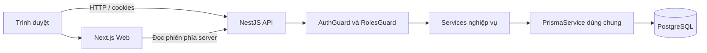
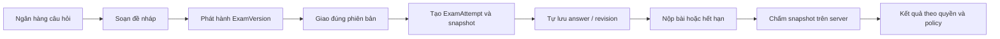

# Kiến trúc ExamSpace

ExamSpace là pnpm monorepo gồm ứng dụng Web, API và package dùng chung. Backend được tổ chức theo modular monolith: các module chạy trong cùng ứng dụng NestJS, không phải các microservice riêng.

```text
apps/web         Next.js App Router, giao diện theo vai trò
apps/api         NestJS API, nghiệp vụ và truy cập PostgreSQL
packages/shared  Kiểu dữ liệu và schema validation dùng chung
```

## Các thành phần chính



Web hiển thị form, dữ liệu API, trạng thái lưu và điều hướng. API kiểm đầu vào, quyền và trạng thái nghiệp vụ. Controller nhận HTTP và gọi service; không đặt logic chấm điểm hoặc quyết định quyền chỉ ở frontend.

| Module                 | Trách nhiệm                                                     |
| ---------------------- | --------------------------------------------------------------- |
| Auth / Dashboard       | Đăng nhập, refresh/logout, đổi mật khẩu và dữ liệu theo vai trò |
| Users / Classes        | Tài khoản, phân công giảng viên, lớp và thành viên              |
| Questions              | Ngân hàng câu hỏi một đáp án, nhiều đáp án và ghép nối          |
| Exams                  | Bản nháp, thứ tự câu, điểm và phiên bản đề đã phát hành         |
| ExamAssignments        | Người nhận, lịch mở/đóng, giới hạn lượt và chính sách kết quả   |
| ExamAttempts / Grading | Lượt làm, tự lưu, deadline, nộp bài và chấm điểm                |
| Results                | Lịch sử và báo cáo theo quyền, người nhận và phiên bản          |

Các module sử dụng `PrismaModule` để nhận cùng provider `PrismaService`, tránh tạo một pool riêng cho từng module.

## Đăng nhập và phân quyền

Mật khẩu được băm bằng Argon2. API sử dụng JWT qua HttpOnly cookies, refresh rotation và tokenVersion để hỗ trợ thu hồi phiên. Token và password hash không được trả trong JSON dữ liệu nghiệp vụ. CSRF kiểm Origin/Referer cho thao tác ghi; CORS có cấu hình origin cụ thể và credentials.

AuthGuard và RolesGuard kiểm phiên và vai trò. Service tiếp tục kiểm ownership, lớp đang phụ trách, thành viên, người nhận và trạng thái bản ghi. Admin quản lý hệ thống; Teacher làm việc trong phạm vi được phép; Student chỉ truy cập bài được giao và lượt làm/kết quả của mình. Việc ẩn nút hoặc chặn route trên Web không thay thế các kiểm tra tại API.

Next server đọc phiên khi render các route cần đăng nhập. Client có cơ chế gộp refresh request và cô lập cache theo vòng đời tài khoản. Cơ chế này không được xem là khóa refresh dùng chung giữa nhiều process hoặc chứng nhận vận hành đa instance.

## Luồng tổ chức thi



Phiên bản đã phát hành lưu nội dung, đáp án, điểm và thời lượng. Lượt làm sao chép snapshot của phiên bản được giao. Chỉnh ngân hàng câu hỏi hoặc phát hành phiên bản mới không viết lại nội dung và điểm lịch sử.

Autosave sử dụng revision để phát hiện xung đột. Giao diện chỉ báo đã lưu khi server xác nhận các chỉnh sửa hiện tại. Draft chưa được xác nhận chủ yếu nằm trong memory; đóng process hoặc mất thiết bị có thể làm mất phần đó.

Deadline do server quyết định dựa trên thời điểm bắt đầu, thời lượng snapshot và lịch đóng bài. Submit và scheduler finalize lượt làm trong transaction; chấm điểm lấy key từ snapshot, không nhận điểm do client gửi. Scheduler xử lý các lượt quá hạn theo từng transaction để một hàng lỗi không chặn toàn bộ đợt quét.

## Kết quả và giới hạn

Điểm và đáp án được công bố độc lập qua `showScore` và `showAnswers`. Student chỉ thấy projection được phép. Báo cáo phân biệt người nhận hiện tại với lịch sử các lượt đã hoàn thành; không suy tổng từ một trang dữ liệu hoặc coi số lượt là số học viên.

Hệ thống chưa được nghiệm thu production về HTTPS/proxy, multi-process refresh, scheduler multi-instance, throughput và screen reader. Native exit từng gặp trên Windows vẫn chưa xác định nguyên nhân. Xem [cấu trúc dữ liệu](DATABASE.md) và [cách kiểm thử](TESTING.md).
