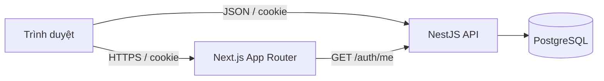
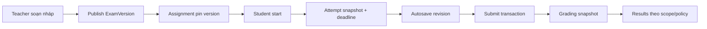

# Kiến trúc ExamSpace — Phase 1–3

Monorepo pnpm gồm `apps/web`, `apps/api`, `packages/shared`. Next.js App Router hiển thị giao diện; NestJS modular monolith có Auth, Dashboard, Prisma, Users, Classes, Questions, Exams, ExamAssignments, ExamAttempts, Grading và Results. Controller nhận HTTP, áp guards/validation và giao cho service xử lý; PrismaService dùng Prisma ORM với PostgreSQL. Grading là service nội bộ, không có endpoint nhận điểm từ client.

`POST /auth/login` kiểm tra mật khẩu Argon2 và đặt access token 15 phút cùng refresh token 7 ngày bằng HttpOnly cookies. Chỉ hash refresh token được lưu trong `User`. `POST /auth/refresh` xác minh và xoay token; `POST /auth/logout` thu hồi phiên; đổi mật khẩu tăng `tokenVersion` để vô hiệu hóa access token cũ. AuthGuard xác thực cookie và trạng thái tài khoản ở mỗi request; RolesGuard trả 403 cho vai trò sai. Dashboard route phía Next kiểm tra `/auth/me` trên server rồi gọi API dashboard theo vai trò qua TanStack Query. API vẫn là nơi quyết định quyền truy cập dữ liệu.

CSRF middleware chặn mọi mutation thiếu trusted Origin/Referer, kể cả login/refresh/logout. Danh sách tin cậy là WEB_ORIGIN và CSRF_TRUSTED_ORIGINS chính xác; Origin null/khác origin bị 403. SameSite=Lax và CORS credentials không thay thế CSRF. Secure chỉ bật khi NODE_ENV=production; HTTPS/reverse proxy/cross-site cần nghiệm thu riêng.

Secrets đến từ biến môi trường; seed chỉ dành development. Swagger tại `/docs`. AuthGuard kiểm chữ ký, kind, tokenVersion và isActive; RolesGuard quyết định vai trò, service kiểm ownership. Refresh dùng compare-and-swap hash trong PostgreSQL để chỉ một request thắng rotation. Không trả JWT/hash trong JSON. SSR dashboard hiện chỉ GET /auth/me; access hết hạn ở SSR dẫn về login, không xoay cookie trong server component. Đây là giới hạn UX cần phân biệt với refresh client.

Client gộp các request refresh đang chạy trong cùng module/tab và theo dõi generation để 401 cũ không xoay lần nữa. Đây không phải khóa liên tab/process SSR. Logout nhận refresh JWT có chữ ký hợp lệ, chưa hết hạn, cùng tokenVersion để thu hồi version đó ngay cả khi hash vừa được rotation thay; logout lặp không tăng version lần nữa. Token cũ vẫn không được dùng để refresh. Chính sách là thu hồi phiên ở cấp user/tokenVersion, không có bảng nhiều phiên thiết bị độc lập.

## Luồng thi và tính nhất quán

- Exam là nháp hiện tại; publish tạo ExamVersion có snapshot đầy đủ câu/đáp án/điểm/thời lượng. Sửa bản đã publish tạo version mới. Assignment pin version; draft v2 không làm v1 mất hiệu lực, archive không nhận lượt mới. Snapshot attempt được sao chép từ version đã pin, không đọc key ngân hàng hiện tại khi chấm.
- Start khóa assignment, kiểm recipient, giờ mở/đóng và số lượt; đồng thời start trả cùng lượt IN_PROGRESS. Khi còn lượt IN_PROGRESS, thay đổi lịch assignment bị 409; thay policy công bố vẫn được phép.
- Tên và thời lượng assignment được chiếu từ snapshot version đã pin; Results dùng snapshot của attempt thực tế. Report có metadata riêng từng assignment/version và attempt; tiêu đề cấp Exam chỉ là tên hiện tại của nhóm báo cáo. Legacy thiếu metadata có nhãn không khả dụng, không tự gán tên Exam mới. Không đưa private snapshot/answer key vào JSON assignment.
- Deadline hiệu lực là min(deadline đã lưu, startedAt + duration snapshot, closesAt). GET/save/submit/scheduler suy ra và persist null deadline legacy dưới row lock. Assignment thiếu pinned version bị từ chối rõ, không tự chọn latest. Đồng hồ frontend chỉ hiển thị; giờ server quyết định ghi/nộp.
- Mỗi câu autosave có revision CAS; retry cùng payload/revision idempotent, stale/gap 409. Queue frontend theo câu giữ dirty/editVersion/confirmedVersion/timer/inflight/error; chỉ báo saved khi mọi sửa mới nhất đã xác nhận. Conflict tab khác cần xác nhận trước ghi tiếp. Submit khóa UI, flush queue, rồi gọi backend; offline chưa xác nhận chỉ ở bộ nhớ.
- Scheduler mỗi 15 giây quét tối đa 100 IN_PROGRESS quá hạn/null deadline, transaction từng lượt, log lỗi theo ID và tiếp tục hàng khác. Submit và autosave khóa cùng hàng attempt; submit lặp không chấm lại. Score, awarded và status commit/rollback cùng nhau. SINGLE đúng toàn bộ, MULTIPLE đúng tập chính xác, MATCHING đúng toàn bộ; sai/bỏ trống 0, tính bằng cents rồi Decimal.
- reviewQuestionIds được lưu riêng trên attempt, không tạo answer/revision và không ảnh hưởng điểm. Progress/navigation/current question là trình bày phía frontend; dữ liệu trả lời/review/deadline đã xác nhận được khôi phục từ server.

## Quyền và lịch sử

Admin quản trị toàn hệ thống. Teacher sửa đề/câu thuộc mình, sửa thông tin lớp mình; chỉ Admin phân công lại Teacher. Student chỉ đọc assignment được nhận và attempt/result của chính mình. Public snapshot không chứa answer key; Results ẩn điểm/counts/awarded hoặc key/explanation theo showScore/showAnswers hiện tại.

Assignment list/detail/roster/counts và Results lớp theo Teacher **hiện quản lý lớp**, không theo tác giả đề. Báo cáo hợp roster hiện tại với người có attempt hoàn thành; học viên rời lớp/khóa vẫn giữ lịch sử. Direct result đòi Teacher là người giao và hiện quản lý Student qua membership. Đổi Teacher chuyển quyền lớp; rời mọi lớp làm mất quyền Teacher với direct result. Không lưu roster snapshot: thêm/xóa membership thay quyền list/start của assignment lớp, attempt cũ vẫn được owner đọc/nộp theo deadline.

Tests có version trong `tests/` dùng HTTP/SQL/browser thật, bổ sung Jest unit/service PostgreSQL và pure unit queue. Các báo cáo lịch sử giữ nguyên; tổng hợp công khai nằm trong [release summary](PHASE3_RELEASE_SUMMARY.md), không suy từ số tests thành coverage hoặc production readiness.
