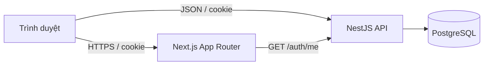

# Kiến trúc Phase 1

Monorepo pnpm gồm `apps/web`, `apps/api`, `packages/shared`. API là một NestJS modular monolith, hiện có `Auth`, `Dashboard`, `Prisma`; các miền nghiệp vụ tiếp theo sẽ là `Users`, `Classes`, `Questions`, `Exams`, `Assignments`, `Attempts`, `Reports` trong cùng ứng dụng. Controller nhận HTTP và giao cho service xử lý; PrismaService giữ kết nối PostgreSQL.

`POST /auth/login` kiểm tra mật khẩu Argon2 và đặt access token 15 phút cùng refresh token 7 ngày bằng HttpOnly cookies. Chỉ hash refresh token được lưu trong `User`. `POST /auth/refresh` xác minh và xoay token; `POST /auth/logout` thu hồi phiên; đổi mật khẩu tăng `tokenVersion` để vô hiệu hóa access token cũ. AuthGuard xác thực cookie và trạng thái tài khoản ở mỗi request; RolesGuard trả 403 cho vai trò sai. Dashboard route phía Next kiểm tra `/auth/me` trên server rồi gọi API dashboard theo vai trò qua TanStack Query. API vẫn là nơi quyết định quyền truy cập dữ liệu.

`SameSite=Lax`, JSON request và CORS chỉ cho `WEB_ORIGIN` bảo vệ luồng phát triển trên cùng site. Khi triển khai cross-site hoặc thêm thao tác nhạy cảm mới, bổ sung CSRF token và cấu hình cookie domain/secure theo topology thực tế. HTTPS bắt buộc ở production.

Secrets đến từ biến môi trường; không có tài khoản seed cố định ngoài development. Swagger tại `/docs`. Bộ kiểm thử hiện tập trung vào xác thực và phân quyền; các module nghiệp vụ Phase 2 cần kiểm thử tích hợp PostgreSQL.
