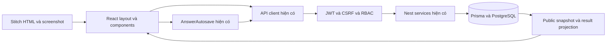

# Stitch → ExamSpace: kế hoạch triển khai UI và tích hợp

## 1. Cơ sở và quyết định phạm vi

Ngày: **01/11/2026, Asia/Saigon**. Dựa trên dữ liệu đọc thật từ project PRIVATE **Multi-Role Education Portal**, ID `16397645008301072963`; source ExamSpace tại HEAD `a1e2891754e399aa4743e32c8218759938149bdc`, branch `feature/phase-3-examination`.

Audit chi tiết: [STITCH_EXAMSPACE_SCREEN_AUDIT.md](STITCH_EXAMSPACE_SCREEN_AUDIT.md). Mã S01–S09, C01–C18/L01–L02 và K01–K20 theo báo cáo đó. Đây là kế hoạch, **không phải source đã triển khai, API đã tồn tại hoặc migration đã được duyệt**.

Đề xuất chia phạm vi triển khai thành hai đợt có sản phẩm review được:

1. **Đợt UI Phase 1–3:** dùng ngôn ngữ Academic Focus, đổi thương hiệu về ExamSpace sau chốt; làm lại shared shell, editor, workspace, results và quản lý hiện có bằng các API hiện hữu. **Không cần migration hoặc backend mới chỉ để đổi UI.** Các control chưa có nghiệp vụ phải bỏ khỏi scope hoặc hiển thị trạng thái chưa hỗ trợ đã được chốt; không nhận click rồi alert thành công giả.
2. **Đợt chức năng mở rộng:** ordering/partial credit, media/tự luận/manual grading, analytics nâng cao, export chính thức, adaptive/AI/chat/OCR/appeal/proctoring. Chốt yêu cầu, contracts, storage và schema trước UI viết dữ liệu. Tận dụng các module hiện có và thêm service/endpoint ở nơi phù hợp; không tạo lại Auth/Users/Class/Exam/Attempt/Results.

Những gì audit chưa chốt: thương hiệu, palette/radius có xung đột, single-question so với scroll list, thiết kế Login/Admin/Classes còn thiếu, dữ liệu dùng xếp hạng, policy grade review/feedback release, phân biệt practice với exam, yêu cầu export/certificate và dịch vụ AI/media. Không coi header role “Giảng viên” trong tất cả screens là chính sách quyền.

## 2. Kiến trúc và giới hạn phải giữ

Chỉ lấy cấu trúc thị giác từ Stitch. Không port inline handlers, CDN Tailwind config, role dropdown, timer simulation, mock correctness hoặc submit alert vào production code.

### Các bất biến không được thay đổi theo UI

- **Auth:** access/refresh HttpOnly cookies; request credentials include; refresh rotation CAS/logout tokenVersion; no-JS login POST fallback và disabled trước hydration. Role/backend identity từ server, không localStorage role.
- **CSRF:** exact Origin/Referer của mọi mutation, kể cả login/refresh/logout; không bỏ middleware để làm screen hoạt động. CORS không phải cơ chế chặn side effect.
- **Ownership:** Question/Exam write theo tác giả; Classes Teacher owner, Admin mới được reassignment. Assignment read/roster/count và Results theo current class manager; direct cần creator + current managed membership. Teacher tác giả đề không mặc nhiên đọc lớp khác.
- **Version:** publish bất biến; draft mới không chặn assignment cũ; explicit examVersionId pin; metadata title/duration lấy đúng version/snapshot; không fallback mutable bank/key khi thiếu legacy metadata.
- **Attempts:** actor Student owner/recipient; revision liên tiếp/idempotent; 409 không tự overwrite local/latest draft; giữ aggregate saved/pending/error chính xác.
- **Deadline:** server effectiveDeadline, legacy null, assignment close và scheduler; không restart deadline khi reload; schedule đổi khi IN_PROGRESS vẫn409.
- **Submit/grading:** lock edit → flush mọi answer → submit; transaction + idempotency; score integer cents ở backend và chấm snapshot. Không tạo endpoint công khai nhận score Student.
- **Results:** Student own; showScore/showAnswers độc lập; hidden score không chuyển0, hidden key không fetch từ bank; áp cùng scope/policy cho chart/export/cache/download.

## 3. Thứ tự triển khai đề xuất

Các giai đoạn 1–7 ưu tiên dùng backend sẵn có. Giai đoạn 8 là tổng hợp tích hợp và chỉ mở rộng API đã chốt; việc nối API hiện hữu diễn ra ngay trong mỗi giai đoạn. Tests viết/chạy theo từng bước, giai đoạn9 là gate kết hợp, không đợi xong UI mới nghĩ đến regression.

| Bước                                   | Phạm vi/file hiện hữu cần sửa khi được giao triển khai                                                                               | Kết quả review được và gate                                                                                                                                                                             |
| -------------------------------------- | ------------------------------------------------------------------------------------------------------------------------------------ | ------------------------------------------------------------------------------------------------------------------------------------------------------------------------------------------------------- |
| 1. Shared layout/tokens/components     | `app/globals.css`, `app/layout.tsx`, `components/dashboard-shell.tsx`, `components/ui/{button,input,card}.tsx`, pagination/providers | Token contract/font/theme; shell role-aware dùng chung; form/table/dialog/toolbar/palette states; snapshots desktop/mobile. Không bọc thêm main lồng main.                                              |
| 2. Authentication/Login                | `/login`, `login-form.tsx`, `/login/unavailable`                                                                                     | Áp style theo tokens vì chưa có Stitch Login; giữ email/password/RHF/Zod, POST/no-JS, errors/loading, role redirect. Không thêm đăng ký/social login khi thiết kế không có.                             |
| 3. Admin UI                            | `/admin/users`, `/admin/classes`, `/admin/exams`, management/detail/admin-exam-monitor                                               | Users/Class forms/tables/filters, status/reset/reassignment và monitor; nối C02/C03/C09/C17. Không biến S07 thành quyền xem hệ thống cho Teacher.                                                       |
| 4. Teacher UI                          | Questions/Classes/Exams/new/edit/detail/Assignments; exam-management, exam-assignment-management, question-form                      | S05 thích nghi ba type hiện có; order/points/version/bank/publish/assign vẫn đầy đủ. Bổ sung input explanation hiện backend đã hỗ trợ nếu cần hiển thị lời giải; không cần API mới.                     |
| 5. Student UI                          | `/student/classes`, `/student/exams`, `/student/results`; student-exams/results                                                      | Assigned/start/continue/closed/max attempts/history page; giữ empty/loading/error, >20 records; không lấy mock nhiều lớp/roster bạn học.                                                                |
| 6. Exam workspace                      | `/student/attempts/[id]`, attempt-workspace; giữ nguyên `lib/answer-autosave.ts` trừ yêu cầu sửa được test                           | S08 header/timer/options/matching/nav/review/submit dialog; desktop side palette và mobile drawer; không có ordering/AI badge giả trong đợt1. Gate autosave/network/submit bắt buộc trước sang results. |
| 7. Results/reports                     | student-results, teacher-results, admin-exam-monitor                                                                                 | S01/S06 chỉ core score/answers/explanations; S07 report thật; data adapters theo snapshot, không ép maxScore10. Aggregate mở rộng theo N01 nếu được nhận.                                               |
| 8. API integration                     | `lib/api.ts`, shared/types hoặc DTO module hiện hữu, services/controller tương ứng                                                   | Giữ existing routes/payloads; thêm response types bớt any theo phạm vi sửa. N01–N12 chỉ triển khai nếu nhận scope; Zod + guards + scope + tests trước UI success.                                       |
| 9. Unit/integration/browser acceptance | Specs và tests/p0/p1/p2/git-review có sẵn, bổ sung component/visual tests có mục đích                                                | Các gate ở mục8; trace từ screen/control → request → SQL test fixture; không dùng Stitch mock làm API response thành công giả.                                                                          |

### 3.1 Shared design và layout

- Chốt một bảng tokens thống nhất giữa namedColors, design MD và HTML: primary vs primary-container, surface/background, on-colors, radius và timer thresholds. Đề xuất lấy HTML/machine colors làm baseline nhìn thấy; mọi đổi sang prose palette phải có review contrast/visual riêng.
- Font Plus Jakarta Sans có glyph tiếng Việt và fallback; dùng asset/font pipeline của app, không `<script src=cdn.tailwindcss.com>` hoặc phụ thuộc URL ảnh AIDA tạm. Giữ lucide-react nếu đủ icon để tránh thêm dependency chỉ vì font icons.
- App hiện chỉ DashboardShell có sidebar; tạo layout chung cho nhóm route Admin/Teacher/Student hoặc shell composable. Bảo đảm SSR auth boundary và không thêm refresh rotation vào Server Component nếu chưa có thiết kế cookie flow.
- Exam focus layout riêng: bỏ menu quản trị gây xao nhãng nhưng vẫn đúng navigation/back-result. Queue và câu trả lời ở parent không bị unmount khi chuyển câu hoặc mở drawer.
- Đặc tả các trạng thái `loading/empty/error/disabled/saving/saved/conflict/expired`, không chỉ happy state của Stitch. Table có caption/headings, filter labels, keyboard/focus-visible, scrollbar có thể dùng.
- Responsive cần thêm thiết kế 390/768/1024/1440; S03/S05/S07 sidebar/main fixed offset phải thu gọn, toolbar wrap, table horizontal scroll nằm trong container. Không coi utility classes trong DESKTOP HTML là bằng chứng responsive đạt.
- Hỗ trợ theme hiện có; Stitch chỉ LIGHT nên dark tokens là quyết định thiết kế bổ sung, chưa có screenshot tham chiếu. Không âm thầm mất dark-mode của app.

### 3.2 Teacher editor và giao bài

Tách ba state/data flows: (1) tạo/sửa Question bank C05, (2) composition Exam draft C06, (3) publish C08 rồi create assignment C10 pin version. Inline editor có thể tận dụng QuestionForm nhưng phải phản ánh rõ cập nhật bank hay composition; không tác động published snapshot cũ. Preview “Học viên” chỉ là cách trình bày trong Teacher page, không cấp preview key cho tài khoản Student.

Thêm tab/filter ba loại hiện có, bank search/topic/difficulty, selected order/points tổng theo cents, keyboard reorder. Giữ limit200 câu và schema duration1..1440/Decimal. Draft rỗng hiện bị backend từ chối; UX giữ local draft trước lần save hợp lệ hoặc đề xuất contract riêng sau review, không báo server đã lưu khi chưa có id.

Một assignment có classId XOR studentId. UI chọn nhiều lớp sẽ tạo từng assignment và hiển thị kết quả từng request (thành công/thất bại/retry tránh trùng), hoặc thêm batch endpoint được review riêng; không nhét array classIds vào DTO hiện tại. Date input chuyển ISO có offset; hiển thị409 khi sửa lịch có lượt đang làm. Không ẩn version selector hiện có chỉ vì Stitch thiếu trường này.

### 3.3 Workspace

Giữ dạng Answer hiện hữu: optionId, optionIds, pairs với leftId/rightId từ public snapshot, không dùng index A/B làm ID. Matching swap/clear/select desktop/mobile và keyboard/touch phải tồn tại sau đổi layout. Đánh dấu câu dùng C14, không ghi answer giả.

Nút Lưu tạm → flush queue hiện có; không tạo revision mới nếu không có edit. Pending/error thuộc mọi câu; đồng hồ hết giờ vẫn do server từ chối/chốt. Dialog nộp lấy số câu/review/save thật, trap/restore focus và chặn double-submit. Reset matching gửi draft rỗng qua queue, không reset revision. Không mặc định có chức năng clear radio: payload SINGLE_CHOICE hiện cần optionId hợp lệ; nếu UX muốn bỏ chọn hoàn toàn phải review contract thêm, không gửi null lén.

Nếu single-question mode được chọn, câu không hiển thị vẫn giữ draft/revision/dirty queue và được flush trước submit. Routing/React key không được thay attempt.id. Scratchpad chỉ local nếu nhận scope, có thông báo giới hạn khôi phục; formula sheet phải phù hợp chính sách đề. Không copy lỗi `previousElementSibling.value=''` trong prototype scratchpad.

### 3.4 Results, reports và mock data

- Title/duration/points/questions lấy attempt hoặc pinned version; current exam title chỉ là nhãn parent trong Teacher index đã phân biệt. Không sửa Question topic mới rồi gán lại lịch sử.
- Score ring có thể biểu diễn score/maxScore khi cả hai có giá trị và maxScore>0. “Thang10”, pass5, top10% hoặc “Giỏi” phải có policy, không mặc định score raw của đề bất kỳ là /10.
- Timestamp duration là elapsed từ startedAt đến submittedAt; scheduler chốt có thể chậm sau deadline, nên không gọi đó “thời gian làm việc chủ động” hoặc mỗi câu. Cần quy tắc min(deadline,submittedAt) nếu lấy thời lượng thi thực tế, và label nhất quán.
- Search/class/score/period/pagination trên S07 chưa có trong report endpoint. Với dữ liệu nhỏ, derive/filter từ **toàn report đã scope** và ghi rõ phạm vi; với scale bổ sung N01 để count/aggregate/page dùng cùng predicate.
- Export/print dữ liệu đã được phép có thể bắt đầu bằng browser print hoặc client CSV của report đầy đủ, không khẳng định đã có endpoint. Certificate PDF/verification/public sharing là yêu cầu nghiệp vụ khác, cần approval policy trước link public.
- Không render AI feedback, rubric/audio, camera health, learner rank, competency chart hoặc notification unread cho tới khi có contract/data thật. Loading/unsupported/empty phải khác số0.

## 4. API đề xuất nếu nhận toàn bộ phạm vi Stitch

**Không endpoint Nxx nào được triển khai hoặc gọi trong audit.** Đường dẫn là thiết kế đề xuất, phải review naming/OpenAPI/Zod/test trước thực hiện. Dùng lại module có sẵn; không clone các models ExamAttempt/User/Class. Mọi endpoint mới AuthGuard/@Roles và validation, quyền tài nguyên ở service; mọi mutation cookie đi qua CSRF.

| ID  | Hành vi từ Stitch → API đề xuất                                                                                                                 | Request dự kiến                                                                                                                           | Response dự kiến                                                                                    | Quyền/policy                                                                                                                           | DB cần?                                                                                                                                                                      |
| --- | ----------------------------------------------------------------------------------------------------------------------------------------------- | ----------------------------------------------------------------------------------------------------------------------------------------- | --------------------------------------------------------------------------------------------------- | -------------------------------------------------------------------------------------------------------------------------------------- | ---------------------------------------------------------------------------------------------------------------------------------------------------------------------------- |
| N01 | S07 KPI/histogram/comparison/filters/table → GET `/results/exams/:examId/analytics`                                                             | classIds?, examVersionId?, from?, to?, scoreBand?, search?, page/limit, attemptPolicy=latest/best/all, normalizedScale?                   | scope/policy metadata, summary, histogram, classComparison, paged rows, totals; không mock          | Admin hoặc current resultAssignmentScope; mọi aggregate/count/list dùng cùng where; default completed only sau chốt                    | Không cho aggregate cơ bản trên dữ liệu có sẵn; không tạo analytics table chỉ để vẽ chart                                                                                    |
| N02 | PDF/CSV/Excel/certificate/share → GET `/results/exams/:examId/export?format=csv                                                                 | xlsx                                                                                                                                      | pdf`, GET `/results/:id/export`                                                                     | Cùng filters/attemptPolicy như N01; format allowlist                                                                                   | Binary content/type/disposition hoặc scoped async job link có hạn nếu cần                                                                                                    | Admin/Teacher scope; Student own export chịu disclosure; link download kiểm quyền lại, không public guessable | Không bắt buộc export tức thì; certificate có issuance/verification/expiry/revocation thì cần model riêng sau chốt |
| N03 | Ordering/fill/TF/partial credit/random draw/config → mở rộng POST/PATCH `/questions`, `/exams` hiện có; POST `/exams/draft-from-bank` tùy scope | Typed payload discriminated theo type, ordered items/key/scoringPolicyVersion; bank filters/count/seed?; shuffle flags/cấu hình có tên rõ | Draft exam + provenance selection; publish snapshot bao gồm key/policy/config bất biến              | Teacher owner; chosen bank đúng quyền, deterministic replay; không thay v1, không để Student gửi correctness                           | Ordering/fill storage/type cần additive migration; TF có thể SC2 không migration; shuffle lưu snapshot JSON có thể không SQL, persistent config cần review                   |
| N04 | S03 manual draft/approve/return & S06 feedback → GET/PUT `/results/:attemptId/review`, POST `/:attemptId/review/publish`                        | expectedRevision, rubricVersionId, per-criterion marks, overallFeedback; publish empty hoặc reviewRevision                                | Review draft/revision, computed total, gradingState, publishedAt; backend tính sum/range            | Teacher current scope/Admin; quyết định ai grade/approve, historical ownership; Student chỉ published projection riêng; CSRF/CAS/audit | Có nếu manual review/rubric/lifecycle được nhận; giữ original auto-grade và provenance, không overwrite im lặng                                                              |
| N05 | File ảnh/bài nộp/voice/bút phê → POST `/media/uploads`, POST attachment liên kết question/attempt/review; PUT `/results/:id/review/annotations` | mime/size/checksum/resource context; opaque media ID; page/normalized coordinates/type/text/stroke + expectedRevision                     | Upload grant/metadata; server-verified attachment IDs; annotation revision                          | Student own input khi được phép và còn hạn; Teacher scope; download có auth; type/size/ownership/retention; no arbitrary external URL  | Có cho metadata/link/annotations/voice persistence; blob ở storage ngoài DB, không base64 vào answer Json tùy tiện                                                           |
| N06 | S03 OCR/AI rà soát, S01 AI evaluator → POST `/results/:id/analysis-jobs`, GET `/results/:id/analysis-jobs/:jobId`                               | verified media IDs, allowed analysis kind; idempotency key                                                                                | job state, OCR/suggestions/confidence/modelVersion, source references, error; không ghi final score | Teacher scope/Admin, Student chỉ phần đã công bố; providers giữ secrets ở server, allow data/privacy policy                            | Job/provenance thường cần additive model; không gọi AI trong transaction giữ row lock                                                                                        |
| N07 | S04 adaptive / S01,S06 luyện lại → POST `/practice-sessions`, GET `/:id`, PUT `/:id/responses/:questionId`, POST `/:id/check`, POST `/:id/next` | sourceAttemptId?, objective?, answer + expectedRevision; practice policy được server quyết định                                           | Practice snapshot, progress/feedback được phép, next step, separate practice score                  | Student own; Teacher gán cho managed students nếu nhận; không dùng official attempt deadline/key endpoint                              | Có cho practice state/responses/selection/skill progress; tách khỏi official exam scores/maxAttempts                                                                         |
| N08 | Hints/video/AI chat/micro-learning/message → POST `/practice-sessions/:id/hints`, POST `/:id/messages`, GET `/:id/resources`                    | questionId, hintLevel?, messageText?, expected session state                                                                              | Hint/chat/resource data, provenance/usage state; limits/errors                                      | Student owner; không dùng endpoint này để lộ official exam key; consent/rate/budget policy; Teacher message khác AI chat               | Có nếu lưu hint usage/chat/resources/progress; video curated link có thể không DB nếu config tĩnh được chốt                                                                  |
| N09 | S06 phúc khảo → POST `/results/:id/appeals`, GET `/appeals`, PATCH `/appeals/:id`                                                               | Student reason/attachmentIds?; Teacher decision + expectedRevision                                                                        | Appeal id/status/timeline, decision; không tự cập nhật score từ request                             | Student own trong cửa sổ được phép, Teacher current scope/Admin; nếu sửa điểm dùng N04 audit                                           | Có nếu nhận workflow appeal; quy định window/duplicates/resolution                                                                                                           |
| N10 | Mastery/timing/ranking/taxonomy → GET `/results/:id/analysis`, GET `/questions/metadata` hoặc mở rộng bank/snapshot                             | Exam/version/attempt scope, approved scale/class cohort; topic/skill filters                                                              | Topic coverage/correctness, rank with denominator/policy, timing quality/missing markers            | Student own aggregate không lộ peer PII; Teacher scoped; hidden score/key không leak qua insights                                      | Topic/difficulty hiện có; freeze thêm vào **future snapshot JSON** không nhất thiết SQL. Skill/Bloom taxonomy và per-question timing events nếu cần thật thì additive schema |
| N11 | Camera/tab-switch/anti-copy status/config                                                                                                       | Endpoint cấu hình theo exam version + POST `/exam-attempts/:id/proctor-events` nếu nhận                                                   | Config opt-in/retention, event kind/client time/sequence; status từ telemetry thực                  | Student own, Teacher scope; client event không tự đủ bằng chứng gian lận; không đảm bảo khóa hệ điều hành/browser                      | Thường có cho config/consent/events/media retention; nằm ngoài redesign Phase3, cần đặc tả riêng                                                                             |
| N12 | Notifications/teacher actions/PPCT/send/class challenges                                                                                        | GET `/notifications`, PATCH `/:id/read`; POST teaching action/job sau khi chốt domain                                                     | Actor targets/resource refs/idempotency; acknowledgement, delivery state                            | Role/scope trên recipients và actions; Admin-only create Class giữ nguyên. “Tạo lớp phụ đạo” không tự cho Teacher quyền create class   | Có nếu persistent notification/plan/delivery/pairing; giao đề đã có C10, không cần API mới chỉ để mở form prefill                                                            |

### Lưu ý về nhu cầu backend thực sự

- Render LaTeX plain-text, tabs, progress, palette, filter câu, zoom/view mode, browser print, static help và local scratchpad **không tự yêu cầu API/SQL mới**. Cần renderer/accessibility/tests phù hợp.
- Cập nhật lời giải question đã có C05; UI QuestionForm hiện chưa nhập explanation. Không dựng lại QuestionsService để thêm một trường form backend đã nhận.
- S07 “Tái phân tích” thống kê cơ bản có thể là refetch; không nhất thiết POST job mới. AI analysis mới dùng N06.
- S07 “Giao đề thử thách/Tạo Mini-test” có thể prefill Exam draft/Assignment hiện có cho ba type; “adaptive” thực sự cần N07. Teacher tạo lớp mới hiện bị backend chặn: phải đi Admin hoặc thay policy được review, không chỉ thêm button.
- Prototype 4 Bloom levels không tương đương Difficulty EASY/MEDIUM/HARD. Không tự map 40/30/20/10 thành 3 mức rồi tuyên bố đúng yêu cầu.
- Các dates/grade/semester/student code/signature/certification không có trong schema; chỉ thêm khi có định nghĩa và nguồn thật. Hiện `.id` UUID hoặc class.code không đại diện mã thí sinh/SBD.

## 5. Database: migration nào có thể cần

**Đợt UI không đề xuất SQL migration mới.** Schema hiện có đủ User/Class/ClassMember/Question/Option/MatchingPair/Exam/ExamQuestion/ExamVersion/ExamAssignment/ExamAttempt/AttemptAnswer. Năm migration lịch sử giữ nguyên. Audit không kết nối để xác minh applied state hôm nay, không generate/deploy migration.

Nếu scope mở rộng được chấp thuận, review từng thay đổi additive riêng:

| Nhóm                                | Hướng schema để review, chưa quyết định cuối                                                                                                                                            | Tương thích và dữ liệu lịch sử                                                                                                                                                             |
| ----------------------------------- | --------------------------------------------------------------------------------------------------------------------------------------------------------------------------------------- | ------------------------------------------------------------------------------------------------------------------------------------------------------------------------------------------ |
| Ordering / fill / essay             | Mở rộng QuestionType và cấu trúc payload tương ứng (items/answer specification/text response); không ép vào MatchingPair. Thêm snapshot schema/key/scoring policy version trước publish | Parser hỗ trợ đồng thời ba type cũ; giữ score all-or-zero của v1. Partial credit mới phải đóng băng policy và integer cents, có deterministic rounding. Không cập nhật applied snapshot cũ |
| Manual grading/rubric               | Review/RubricVersion/criterion marks + grading state/revision/author/timestamps; published feedback và original grade provenance                                                        | Không dùng SUBMITTED/EXPIRED làm trạng thái “đã chấm tự luận” nếu chưa chốt. Grading workflow được version; race hai reviewer/publish phải CAS/lock và audit                               |
| Media/annotations/voice/OCR jobs    | MediaAsset + ownership/link tới question/attempt/review; annotation page/coordinates; analysis job/provenance/retention                                                                 | Không xóa/đổi key AttemptAnswer cũ; download scoped, stable media ID; legacy không có attachment là empty, không lỗi                                                                       |
| Practice/AI/learning progress       | PracticeSession/PracticeResponse/HintUsage/ResourceProgress hoặc model tương đương; chat nếu cần lưu                                                                                    | Không tính practice vào official ExamAttempt score/maxAttempts; Student không thể tự chọn “practice” để bỏ deadline của bài thi                                                            |
| Appeals/notifications/teaching plan | Appeal workflow/audit, Notification/recipient/delivery; teaching plan chỉ nếu domain được nhận                                                                                          | Foreign keys/resource scope + không tự purge hồ sơ cũ; chính sách lịch sử khi Teacher đổi lớp rõ ràng                                                                                      |
| Analytics metadata/events           | Topic/difficulty đã có ở Question; freeze vào snapshot JSON phiên bản mới. Thêm Skill/QuestionSkill/Bloom hoặc question events chỉ nếu cần dữ liệu đó                                   | Không backfill topic/thời gian lịch sử từ bank mutable như sự thật. Analytics trả unavailable/coverage. Timing client không trusted để gia hạn/chấm                                        |
| Exam configs / certificate          | Config lưu snapshot JSON hoặc cột policy mới theo nhu cầu draft/version; certificate issuance nếu cần verify/revoke                                                                     | Default cho phiên bản mới, không đổi schedule/deadline/keys của attempt cũ; không cấp certificate cho score chưa công bố                                                                   |

Không dùng schema migration để giải quyết việc đổi màu/font/sidebar. Không đề xuất DROP, reset hoặc sửa `_prisma_migrations`. Nếu một implementation thực sự đòi migration, phải có SQL additive review, backup/restore/preservation trên test DB riêng và bước deploy riêng theo runbook; không coi audit này là phê duyệt deploy development/production.

## 6. File/component mapping cho đợt UI

| Source hiện tại                                                        | Thay đổi dự kiến                                                   | Phần cần giữ                                                                                 |
| ---------------------------------------------------------------------- | ------------------------------------------------------------------ | -------------------------------------------------------------------------------------------- |
| `app/globals.css`, `app/layout.tsx`                                    | Semantic variables/font/background/typography                      | Root providers/lang vi, theme, no token leakage                                              |
| `dashboard-shell.tsx`                                                  | Refactor shared role shell/breadcrumb/nav/mobile drawer            | Logout/auth role và query cache; không dựng role switch quyền mới                            |
| `ui/button.tsx`, `input.tsx`, `card.tsx`, pagination                   | Tokens/states/focus/spacing; table/dialog components nếu cần       | Native semantic controls, disabled/error, no broad global scrollbar hiding                   |
| `login-form.tsx`                                                       | Style đồng bộ; thiết kế thích nghi chưa có Stitch Login            | POST fallback/hydration guard/RHF/Zod/password handling                                      |
| `management.tsx`, `management-detail.tsx`, `question-form.tsx`         | Filters/forms/details/table layouts; explanation input nếu nhận    | CRUD/permissions/error display, bank data/model mappings, teacher reassignment Admin-only    |
| `exam-management.tsx`                                                  | S05 3-pane thích nghi, selected list/preview/version toolbar       | Array order, cents total, bank paging/allPages, Draft/PUBLISHED rules                        |
| `exam-assignment-management.tsx`                                       | Target/version/schedule form + roster UX                           | XOR target/pinned version/max attempts/show policies; schedule409                            |
| `student-exams.tsx`                                                    | Assigned exam list cards/status/start/continue                     | Server validates recipient/remaining/opens/closes; own attempts only                         |
| `attempt-workspace.tsx`                                                | S08 layout/timer/nav/options/submit modal                          | AnswerAutosave coordinator, review API, matching sensors/select/swap, flush pipeline         |
| `answer-autosave.ts`                                                   | Không cần thay cho redesign; chỉ động đến nếu có lỗi/yêu cầu riêng | Per-question dirty/edit/confirmed/revision, controlled retry409/latest draft                 |
| `student-results.tsx`, `teacher-results.tsx`, `admin-exam-monitor.tsx` | S01/S06/S07 core view, chart adapters/filter/table/detail          | Scope theo backend, nullable disclosure, snapshot metadata, historical recipients/pagination |
| `lib/api.ts`, `lib/all-pages.ts`                                       | Type adapters và integrations mới có contract nếu được chốt        | credentials/ApiError/refresh coalescing; không giả response success; không cắt page đầu      |
| Nest controllers/services/schema                                       | Chưa cần đổi cho UI thuần                                          | Giữ modular monolith/services; backend extensions chỉ theo Nxx đã nhận                       |

Tên components mới như AppShell/ExamFocusLayout/QuestionPalette/ResultScoreCard chỉ là đề xuất tách UI. Không tạo file hoặc đổi route trong audit này. Admin report hiện dùng teacher-prefixed routes có allow Admin; nếu đổi route canonical cần redirect/navigation regression, không tự coi đó là lỗ hổng backend.

## 7. Hợp đồng tích hợp và thứ tự dependency

1. Chốt screen/control nào dùng Cxx, Lxx, Nxx; dựa phụ lục inventory của audit, không tạo API cho một nút chỉ là navigation.
2. Dùng API types và view adapters để chuyển Decimal/date/null thành UI; validation input Zod trước backend và service giữ authority.
3. Query keys bao gồm actor/resource/version/filter/page; khi logout/role session thay đổi phải clear cache. Nhiều components dùng `[me]` không được sinh role riêng.
4. Permission change phải phản ánh403, không replay roster/count cũ sau reassign. Không gom dữ liệu toàn hệ thống rồi filter chỉ trên frontend cho Teacher.
5. Thiết kế mới không được bỏ fields API đang yêu cầu hoặc gửi unknown flags rồi mong server lưu. Thêm contract trước khi bật control mới.
6. Nếu ordering/manual/AI được nhận: schema/payload/parser/grading/result projection tương thích → API tests → UI mới → browser tests. Không bật UI trước parser hoặc dùng broad any để che type mới.
7. Public API thiếu dữ liệu thì trả empty/unavailable đúng nghĩa; frontend không tự điền top %, timestamp, chữ ký, OCR confidence, server health hoặc “đã lưu”.

## 8. Test plan cụ thể

Các ca sau là **kế hoạch chưa chạy**. Dùng lại suite đã có trong Git; tests mới chỉ bổ sung cho rủi ro/tính năng mới hoặc invariants có thể bị refactor phá. Không viết test chỉ kiểm class CSS mirror implementation.

### 8.1 Unit/component

- Token adapters/score view: Decimal strings, zero/null, maxScore không10 hoặc0/unavailable, normalized percentage không sai disclosure.
- Form mapping ba Question types, explanation field, selected order/points cents; chuyển filters/page giữ selection; date chuyển ISO đúng timezone.
- Giữ 9 autosave tests `apps/web/tests/answer-autosave.test.mjs`: A fail3 rồi B, delayed A→B, success câu khác không che pending/error, 409 explicit conflict.
- Workspace single-question/drawer nếu nhận: hidden question còn dirty được flush, fieldset/submitting đúng, modal focus/confirm/double click; không kiểm bằng fake saved label.
- Analytics được nhận: definition latest/best/all, denominators, normalized scores/version mismatch, empty/no-score, class/group isolation; partial credit regression nếu thêm.

### 8.2 HTTP/PostgreSQL integration

Tái sử dụng `tests/p0-api.test.cjs`, `p1-api.test.cjs`, `p2-api.test.cjs`, `git-review-api.test.cjs`, `p1-migration.test.cjs` và hai Jest PG integration specs. Bắt buộc test database riêng `online_exam_phase3_test`, configured loopback port khác5432, SQL cluster identity khác development theo `tests/test-database.cjs`; không bỏ guard, không dùng database restore chứa tài khoản thật làm fixtures.

- Auth401/role403, ownerIDOR, locked user; Origin sibling/null/missing và trusted mutation; refresh CAS/replay/logout race.
- Reassign Teacher A→B: A mất roster/list/count/report/detail/export/analytics; B và Admin được đọc; direct sau mất membership Teacher mất quyền. Student chỉ own count/attempt/result.
- Publish v1 → assign v1 → draft/publish v2 đổi title/duration/key; v1 list/detail/submit/grade vẫn đúng snapshot. Reject foreign/future/no-pin/archived new-start đúng policy.
- Autosave revision stale/gap/retry, submit hai thứ tự, transaction rollback; null deadline/save chờ lock qua deadline; patch schedule409; scheduler/backlog/restart giữ idempotency.
- Review flags persist nhưng không thay Answer revision/grade. Historical completed former/locked recipients vẫn nằm report đúng scope.
- API mới nếu nhận: payload invalid400, hidden key/score, scope on actual aggregate/file query, upload size/type/resource ownership, reviewer CAS/history/audit, practice không làm thay official grade, duplicate jobs/appeals/idempotency.
- Migration mới nếu nhận: DB test mới deploy lịch sử→fixtures→additive; fingerprint dữ liệu/checksums cũ giữ nguyên; legacy parser/read/grading tiếp tục hoạt động. Không chạy migration preservation trên development.

### 8.3 Browser và visual

Giữ `tests/p0-browser.test.cjs`, `p1-browser.test.cjs`, `p2-browser.test.cjs`, `git-review-browser.test.cjs`; điều chỉnh locator theo semantic label hợp lý, không giảm assertions nghiệp vụ để làm test xanh.

- Main flow: Teacher login → tạo3type → editor points/reorder → publish/giao đúngversion/lớp → Student start →3type/queue/reload/submit → Student/Teacher/Admin results; điểm thật theo test fixture6.75/6.75.
- Abort/delay requests A/B cho cả3type, request hai câu reverse response, offline/retry/2tabs409/submit pending. Mock chỉ fault delay/abort, **response success phải từ backend thật**.
- Login JS/no-JS/prehydration/wrong password/backend unavailable; không password trong URL/history; không dùng account development làm fixtures.
- Matching full selection swap/clear, mouse/physical touch/keyboard và select; selection/review/progress khi palette chuyển drawer; countdown khi browser clock đổi.
- > 20 exams/assignments/results, page2 loading/total/filter reset, bank/exam/class/student picker ngoài page1.
- Visual mới: 390/768/1024/1440, long Vietnamese text, 200%zoom, sidebar close/escape/focus, sticky header/footer không che input, table container scroll, font load và reduced motion. Dark mode cần reference bổ sung hoặc decision rõ.
- Axe/labels/keyboard + screen reader thủ công cho dialog/palette/timer announcements/table headings/errors. Không copy việc announce timer mỗi giây gây ồn; cần review aria-live tần suất và urgency.
- Stitch screenshots làm tham chiếu thị giác; S05 blank/S07 clipping/raw LaTeX không được biến thành expected “đúng”. Chỉ tạo baseline visual sau chốt và review ảnh app thật.

### 8.4 Gate trước bàn giao implementation tương lai

Trong môi trường test đã xác minh và cấu hình đầy đủ, chạy: `corepack pnpm typecheck`, `lint`, `build`, `test`, `test:integration`, `test:e2e`, `format:check`, `git diff --check`. Generate nếu schema/client đổi nhưng **generate không migrate**. Giữ fingerprint và báo cáo migration riêng nếu có SQL mới. Nêu riêng các gate không chạy được, CI missing/pending/fail không thành PASS.

Số tests146/73 trong các báo cáo trước là evidence lịch sử, không phải threshold coverage hoặc kết quả của redesign chưa làm. Gate production HTTPS/Secure-cookie/reverse proxy/cross-site, refresh multi-tab/process SSR, scheduler multi-instance và WCAG toàn hệ thống vẫn độc lập.

## 9. Tiêu chí hoàn thành và phạm vi được ưu tiên

Đợt UI đủ điều kiện review khi:

1. Mọi screen/control nhận scope có route/data contract/role matrix và loading/empty/error states; các chức năng ngoài scope không giả lập thành có sẵn.
2. S05/S08/S01/S06-core/S07-core phản ánh dữ liệu thật; không làm mất MULTIPLE_CHOICE hoặc version selector chỉ vì screenshot thiếu.
3. Shared layout/tokens hoạt động trên các viewport đã chốt, không ảnh hưởng JWT/CSRF/queue/deadline/grading/result visibility.
4. Các tests hồi quy quan trọng ở mục8 đạt bằng API/PG/browser thật và diff review có phạm vi; không dùng số pixel hoặc số test thay nghiệm thu nghiệp vụ.
5. Không có migration cần cho UI thuần. API/schema mở rộng chỉ vào đợt được giao riêng, đã review contract/migration/test và không đổi lịch sử Phase3.

**Thứ tự ưu tiên:** shared shell/tokens → login → Admin quản lý → Teacher bank/editor/assignment → Student list/history → workspace (gate autosave) → results/report → phần API mở rộng được chọn → acceptance kết hợp. Studio tự luận/adaptive/proctoring chưa nên chen vào đợt đổi UI đầu vì chúng thay đổi mô hình nghiệp vụ, không chỉ bố cục.

## 10. Trạng thái audit này

Chỉ tạo hai báo cáo được yêu cầu; không triển khai các component/API/model/SQL đề xuất. Không sửa Stitch, source ứng dụng, config, `.env`, database hoặc migration; không stage/commit/push. Git/private report preservation và format/link checks được ghi ở phụ lục D của audit. Typecheck/lint/build/tests ứng dụng **chưa chạy trong audit chỉ đọc**; không có kết luận runtime acceptance mới.
