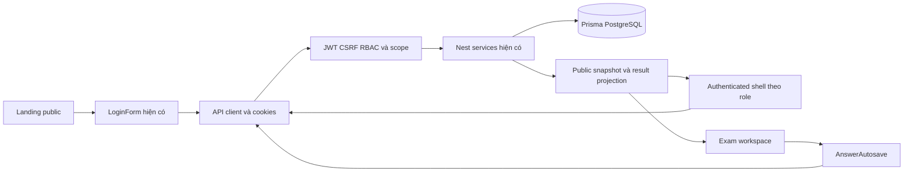
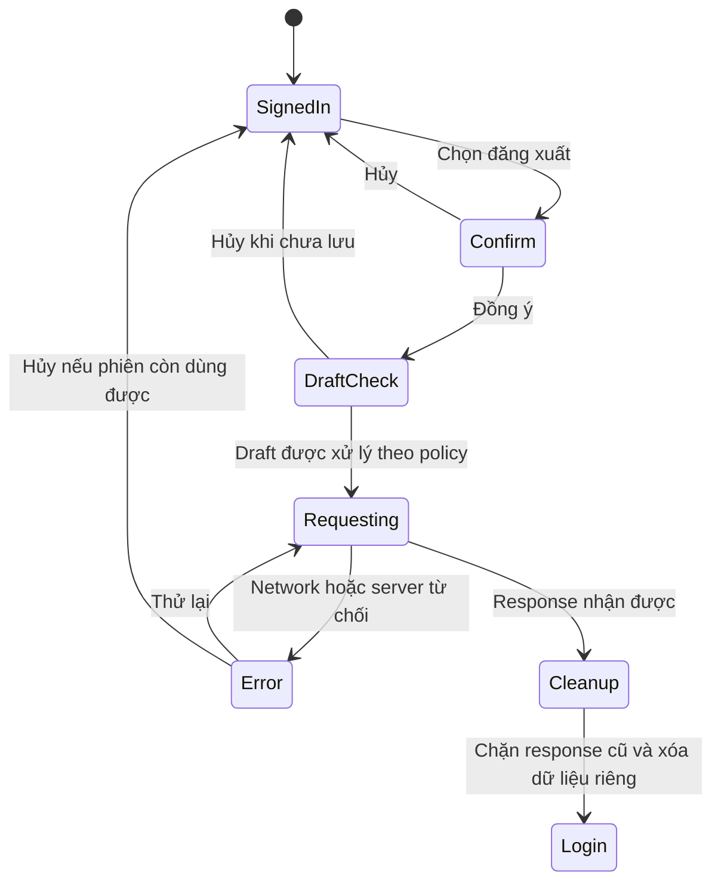

# Stitch → ExamSpace: Implementation Plan V2

## 1. Cơ sở và phạm vi

Ngày: **01/11/2026, Asia/Saigon**. Project MCP xác minh: **Multi-Role Education Portal**, `16397645008301072963`. Audit V2 đọc **11 screen resources**, gồm 9 cũ giữ ID và 2 mới: S10 Homepage `59c106effe8e42e3993e50c968ecc043`, S11 Login/Logout `12ddb4b383d049be95e4706b6ead4cfb`. S09 hidden vẫn trùng HTML S08; S02 chỉ là brief. Không có resource dashboard hoặc logout riêng mới.

Source: branch `feature/phase-3-examination`, HEAD `a1e2891754e399aa4743e32c8218759938149bdc`, repository `Online-Examination-System-Git`. Đây là **kế hoạch chưa triển khai**; không phải phê duyệt thêm nghiệp vụ, API hoặc schema.

Tài liệu liên quan: [Audit V2](STITCH_EXAMSPACE_SCREEN_AUDIT_V2.md), [Audit V1](STITCH_EXAMSPACE_SCREEN_AUDIT.md), [Plan V1](STITCH_EXAMSPACE_IMPLEMENTATION_PLAN.md), [Release summary Phase 3](PHASE3_RELEASE_SUMMARY.md). Giữ nguyên hai báo cáo V1; dùng V2 cho thứ tự triển khai có Homepage/Login/Logout. Các contracts C01–C18/K01–K20 và proposal N01–N12 của V1 tiếp tục là nền cho S01–S09; không đổi chúng thành backend đã triển khai.

### Hai phạm vi cần phân biệt

**Đợt UI Phase 1–3:** shared design system, static landing, email/password login, logout theo chính sách hiện hữu, management/editor/assignment/workspace/results đã có. Dùng API và năm migrations hiện tại. Không cần database migration chỉ để đổi layout, font, màu, dialogs hoặc nội dung tĩnh.

**Đợt mở rộng riêng:** SBD/PIN/room lookup, OAuth/SSO/MFA, session devices/current-only revoke, public live schedules có domain mới, notifications/audit/proctor, AI/OCR/manual grading/adaptive/ordering/analytics/export chính thức. Cần chốt yêu cầu/security/contracts/storage trước UI thành công; không nhập vào baseline vì HTML có button hoặc badge.

## 2. Các quyết định UI/UX trước khi thực hiện

Không yêu cầu người dùng phê duyệt lại trong audit này. Bảng dưới là backlog quyết định cho nhiệm vụ triển khai sau; các phương án khuyến nghị chưa được áp dụng vào code hoặc Stitch.

| ID  | Cần chốt                                          | Phương án đề xuất cho baseline                                                                   | Điều kiện trước triển khai                                                                             |
| --- | ------------------------------------------------- | ------------------------------------------------------------------------------------------------ | ------------------------------------------------------------------------------------------------------ |
| D01 | EduTest hay ExamSpace, logo và copy               | Giữ tên sản phẩm ExamSpace, logo asset hợp lệ; nội dung đúng Phase 1–3                           | Không dùng logo broken/sample identity hoặc quảng bá tính năng chưa có như đã hoạt động                |
| D02 | Homepage public hay dashboard                     | `/` là public landing; ba `/dashboard/{role}` vẫn là private workspace                           | Thiết kế guest/loading/authenticated/auth-check-error, không để profile mock trên guest                |
| D03 | Lịch trên landing                                 | Static announcement đã duyệt; schedule cá nhân tại `/student/exams`                              | Nếu muốn public live, chốt projection/visibility/source-of-truth riêng                                 |
| D04 | Ba login panels và fields mới                     | Một logic LoginForm email/password; role cards/tabs chỉ hint/entry                               | SBD/PIN/room/department/OTP/SSO/remember8h bỏ khỏi baseline hoặc chốt scope riêng; role thật do server |
| D05 | Current/all/per-device logout                     | Một action “Đăng xuất” theo chính sách tokenVersion hiện hữu                                     | Không dán nhãn current-only; session isolation là thay đổi Auth riêng                                  |
| D06 | Sau logout về đâu                                 | Giữ `/login` như source hiện tại                                                                 | Nếu chọn `/`, cần guest header, auth refresh/cache/back-history tests; Stitch chưa có destination thật |
| D07 | Có draft/pending save lúc logout                  | Dialog nói trạng thái thật; thử flush khi phù hợp, error cho retry/cancel hoặc xác nhận bỏ draft | Không tự submit bài thi, không bảo đảm “mọi bài đã lưu” từ copy tĩnh                                   |
| D08 | Palette/radius/dark/mobile                        | Machine/HTML tokens làm điểm xuất phát, review contrast và scale                                 | MD prose có màu/radius khác; chỉ LIGHT screenshot, cần chốt dark và nav mobile                         |
| D09 | Dashboard ba role/management chưa có screen riêng | Thiết kế thích nghi dùng component chung trên dữ liệu hiện hữu                                   | Không dựng KPI mới bằng số mock, không coi role card là dashboard                                      |
| D10 | Workspace scroll list hay single-question         | Giữ state/queue ở parent, chọn cách trình bày sau review                                         | Không remount mất draft/timer/revision khi đổi câu/drawer                                              |

## 3. Kiến trúc và các bất biến phải giữ

- **Auth:** HttpOnly access/refresh cookies, credentials include, refresh CAS và tokenVersion. Role lấy từ CurrentUser/backend. Không lưu password/token vào URL/localStorage hoặc thêm role authority từ tab chọn.
- **CSRF:** exact trusted Origin/Referer cho mọi mutation, kể cả login/refresh/logout; không bỏ guard/middleware hoặc sửa CORS để che lỗi side effect.
- **SSR/privacy:** giữ no-store auth fetch, wrong-role redirect và boundary hiện tại; không thêm rotation side effect trong Server Component khi chưa có cookie response flow. Header public không cache profile của người A cho người B.
- **Ownership:** Question/Exam write theo author; Class reassignment Admin; Assignment list/detail/roster/count và Results theo manager hiện tại, direct cần creator + managed membership. Teacher tạo đề không mặc nhiên xem lớp khác.
- **Version:** assignment pin examVersionId, metadata từ pinned/attempt snapshot; published immutable; soạn v2 không chặn assignment v1; legacy thiếu pin không tự chọn latest.
- **Autosave:** per-question revision/editVersion/confirmedVersion, serialize/retry payload, aggregate pending/error, 409 giữ local draft và xác nhận conflict. Không rewrite queue chỉ để gắn animation.
- **Deadline/grading:** effectiveDeadline/server lock/scheduler, schedule 409 khi IN_PROGRESS; khóa edit → flush → submit idempotent, grade server theo snapshot/integer cents. Không chấm từ client hoặc chuyển timer HTML thành nguồn sự thật.
- **Visibility:** Student chỉ own; showScore/showAnswers độc lập; score ẩn là null, không 0; không fetch bank key hoặc leak qua chart/export/cache.

## 4. Thứ tự triển khai cập nhật

Nối API thật và tests trong từng bước. Bước 10 là gate kết hợp; không đợi đến bước cuối mới phát hiện regression login/queue. Thực hiện từng phần review được và chỉ đi tiếp khi rủi ro của phần đó đã được kiểm.

| Bước                               | Screens/routes và file hiện hữu                                                                         | Sản phẩm review được                                                                                                      | Gate trước bước tiếp                                                                                                                       |
| ---------------------------------- | ------------------------------------------------------------------------------------------------------- | ------------------------------------------------------------------------------------------------------------------------- | ------------------------------------------------------------------------------------------------------------------------------------------ |
| **1. Shared Design System**        | globals/layout, ui Button/Input/Card/Pagination, providers/shell                                        | Token map/font/logo, PublicHeader/Footer, AuthenticatedNav, Dialog/Form/Table/Status states; shared responsive primitives | Contrast/focus/keyboard, Vietnamese glyphs, dark policy, 390/768/1024/1440/zoom200; không đổi auth logic                                   |
| **2. Homepage/Landing**            | S10 → `app/page.tsx` hiện redirect `/login`                                                             | Landing `/`, hero/role entry/static info/footer; guest/auth header thật; mobile navigation                                | Không leak protected data; không dùng mock KPI/role/AI status; links không# và đúng route/role                                             |
| **3. Login**                       | S11 → `app/login/page.tsx`, `components/login-form.tsx`, `app/login/unavailable/route.ts`, `lib/api.ts` | Visual redesign trên RHF/Zod email/password, password toggle nếu nhận; errors/loading/disabled/no-JS giữ nguyên           | Ba role login thật, wrong-tab đúng server redirect, 401/403/network, native POST/no-hydration/no password query                            |
| **4. Logout/session navigation**   | S11 action + header S10; DashboardShell/API client                                                      | Confirm/pending/error/retry/cancel, cache/private-state cleanup, destination đã chốt; một policy logout rõ                | Backend request/CSRF thật; invalid/missing cookie và network failures; late response/cache/Back/Forward; pending answers không mất âm thầm |
| **5. Admin UI**                    | `/dashboard/admin`, `/admin/users`, `/admin/classes`, `/admin/exams`; S07 chỉ phần reports              | Users/Class detail/edit/filter/paging/status/reset/reassign, monitor/report dùng dữ liệu thật                             | Admin-only writes, Teacher/Student denial; không mang cluster/device/audit mocks vào monitor                                               |
| **6. Teacher UI**                  | `/dashboard/teacher`, classes/questions/exams/new/edit/detail/assignments; S05                          | Bank/editor/order/points/preview/publish/version/assignment; class detail/roster đủ                                       | Ownership, explicit versions, v1/v2 metadata, schedule409, >20 records, foreign roster403                                                  |
| **7. Student UI**                  | `/dashboard/student`, classes/exams/results index; S01 một phần                                         | Own assignment list/start/continue/closed/max-attempt states, own history/paging                                          | Recipient/IDOR/session expired; no start từ room sample; version/deadline không reset                                                      |
| **8. Exam workspace**              | S08/S09 → `/student/attempts/[id]`, attempt-workspace + queue hiện hữu                                  | Header/timer/options/matching/palette/review/progress/submit dialog, mobile drawer                                        | SINGLE/MULTIPLE/MATCHING, mouse/keyboard/touch, abort/delay/409/2 tabs/flush/race/deadline; không thêm ordering/proctor fake               |
| **9. Results/Reports**             | S01/S06/S07 → Student detail, Teacher report/detail, Admin monitor                                      | Score/key/explanation policy, version title, pagination/historical roster; accessible data tables                         | showScore/showAnswers combinations, former-manager denial, former/locked Student history, no chart/export bypass                           |
| **10. Integration và Browser E2E** | Existing tests p0/p1/p2/git-review + tests mới theo phạm vi                                             | Trace từ screen/control đến request và SQL test, fresh-start docs, visual/a11y smoke                                      | typecheck/lint/build/tests/format; real HTTP/PG/browser, no silent skip, chính xác phần chưa kiểm                                          |

### 4.1 Shared design và layout

Asset thật: Academic Focus `assets/5dc43d0355f042f999caea23b13210e7`, version1, không thay so với V1. Token baseline gồm primary `#3525cd`, container `#4f46e5`, secondary `#006c49`, error `#ba1a1a`, background `#faf8ff`, white surface, on-surface `#131b2e`. Font Plus Jakarta Sans, body15/24 hoặc18/28; spacing4/8/16/24/32, gutters24/mobile12, margins32/mobile16. MD prose và HTML không hoàn toàn trùng; freeze token contract trước khi đổi cả app.

Các component mới là đề xuất: `PublicHeader`, `PublicFooter`, `RolePortalCard`, `AuthPageShell`, `AuthStatus`, `AuthenticatedNav`, `PasswordField`, `LogoutDialog`. Tận dụng ui primitives hiện hữu; tách visual shell khỏi session logic/API. Không port CDN script/config, inline handlers, mock toast, raw external asset URLs hoặc global scrollbar hiding.

App hiện chỉ DashboardShell có sidebar; nhóm management/exam routes chưa đồng bộ shell. Chọn layout dùng chung/composition phù hợp Next routes và SSR boundaries, không lồng nhiều `<main>`, không remount query provider/queue khi chuyển câu. Workspace có focus layout riêng. Header mobile phải có navigation thao tác được thay `hidden xl:flex` đơn thuần.

### 4.2 Homepage và route contract

`/` hiện redirect `/login`; public landing là frontend mới có chủ đích. Static hero/features/approved policy/help/footer không cần API hoặc Prisma models. Loại số mock, tên tài khoản mẫu và claims chưa có; nếu cần mock trong review visual phải gắn rõ demo ngoài production, không biến thành success states.

| Navigation                | Guest                              | Authenticated                                                                        |
| ------------------------- | ---------------------------------- | ------------------------------------------------------------------------------------ |
| Logo/Trang chủ            | `/`                                | `/` public, không tự đổi role                                                        |
| Login/role card           | `/login` với hint UI nếu được chốt | Link workspace đúng role hoặc tùy chọn đổi tài khoản rõ ràng; không ngầm logout      |
| Phòng thi/Kết quả cá nhân | Login trước; chưa biết assignment  | STUDENT `/student/exams` hoặc `/student/results`; start sau khi chọn assignment thật |
| Soạn đề/Bank/Giao bài     | Login                              | TEACHER routes; Admin chỉ các năng lực được backend cho phép, không nhờ chọn tab     |
| Reports                   | Login                              | Teacher scoped report hoặc Admin monitor; không expose class-wide report cho Student |
| Quy chế/Help/Privacy      | Static page/section đã duyệt       | Cùng nội dung public, không có profile cache chung                                   |

Chỉ đọc `/auth/me` khi cần header cá nhân; phân biệt guest401 với network/5xx chưa rõ trạng thái, không flash thông tin user cũ. Chọn server/client auth read phù hợp request/no-store; không thêm token đọc từ JavaScript. Nếu nhận schedule cá nhân trên homepage thì chỉ render sau xác thực với assignments own/pagination và nhãn “Bài được giao cho bạn”; không gọi đó là public schedule.

### 4.3 Login: tái dùng logic, bổ sung presentation

Giữ form `method="post" action="/login/unavailable"`, ready gate `useSyncExternalStore`, RHF/Zod, `isSubmitting`, serverError role alert. Giữ autocomplete username/current-password, labels và validation. Fallback POST 400/no-store không parse/log body; không đổi thành native GET hoặc handler thành công giả.

Hydrated submit chỉ `api.login(email,password)` → 200 safe CurrentUser/cookies → `router.replace('/dashboard/'+user.role.toLowerCase())` và refresh. Nếu giữ ba tabs, role hint không được quyết định quyền, không gửi `role=ADMIN` để nâng quyền và không cố đưa Teacher vào Student route khi tab Student đang chọn.

Thiết kế thêm các state thiếu: pristine/focus/invalid, pending/disabled,401/403/5xx/network error, password visible, success redirect, no-JS, pre-hydration, authenticated revisit. Chốt Enter/keyboard/tab semantics và mobile layout; không dùng div giả form như S11.

SBD/room PIN/department/OTP/remember8h/Google/Microsoft/demo account/recovery hardware key không được tự xuất hiện như control hoạt động trên baseline. Không lưu credentials hoặc secret vào localStorage, URL, toast/log. Có thể giữ hướng dẫn “liên hệ Admin” theo nội dung đã duyệt; public recovery endpoint là scope mới.

### 4.4 Logout: action thật và cache hygiene

Source đã có `POST /auth/logout`, không tạo `/logout` GET side-effect. Request qua `api.logout()` dùng credentials/cookie và CSRF hiện hành; không vô hiệu CSRF khi thêm public header. Logout controller clear HttpOnly access/refresh cookies. Với refresh JWT hợp lệ và CAS update thành công, service tăng **account tokenVersion** và clear hash; AuthGuard từ chối token cũ cùng version. Không có session device registry hoặc per-device isolation.

**Baseline đề xuất:** một action generic “Đăng xuất”, giải thích tác động theo policy được chốt. Không đồng thời cung cấp “chỉ thiết bị này” và “all” như hai semantics đã hỗ trợ. Response204 không trả count/status global-revoke và có thể chỉ clear cookies khi refresh invalid/missing; không báo “3 phiên đã thu hồi”. Tách inventory/per-device UI sang extension nếu được giao.

State machine UI đề xuất:

Từ “Draft được xử lý” không có nghĩa auto-submit. Nếu workspace dirty/error/conflict, hiện đúng số/trạng thái cần xử lý; flush khi hợp lệ, cho retry/cancel hoặc xác nhận mất local data theo policy. Không clear answers trước khi quyết định. Server deadline/scheduler tiếp tục, logout không kéo dài thời gian.

Khắc phục trong nhiệm vụ triển khai: DashboardShell hiện redirect/clear ở `finally` dù request lỗi. Có thể vẫn ẩn private UI ngay vì privacy, nhưng phải báo kết quả phiên **chưa xác nhận**, có cách retry/reauth theo policy; không đồng nhất redirect với backend revoked. JavaScript không thể tự clear HttpOnly cookie khi không nhận được server response. Không sửa hành vi này trong audit V2.

Trước cleanup, chặn/hủy queries mới, cân nhắc cancel in-flight queries + auth generation, clear query/mutation/private component state, reset user-bound stores; test late refresh/me/results responses và account A→B. Cross-tab logout event có thể dùng browser channel sau thiết kế, nhưng không chứa token; phải test race, không tuyên bố coalescing trong một module đã giải quyết nhiều tab/SSR. Sau destination, Back/Forward và direct URL không được hiển thị private data cũ; SSR/API guards vẫn là quyền quyết định.

### 4.5 Admin, Teacher, Student và ba dashboard

Chưa có Stitch resource riêng cho Users/Classes/Question Bank/Assignments hoặc dashboard ba role. Thiết kế thích nghi phải giữ đầy đủ forms/detail/edit/filters/paging/status/reset/reassignment hiện có. `GET /dashboard/{role}` chỉ `{user,section}`; muốn KPI mới cần định nghĩa aggregates/scopes và API riêng, không lấy số mock từ hero.

Teacher editor cần phân biệt sửa bank Question với composition Exam và publish/new-version; dùng đúng `examVersionId` khi giao. Một assignment chỉ một target class XOR direct student; chọn nhiều lớp cần nhiều request có trạng thái từng request hoặc batch contract được review. Giữ cents totals/order, three supported question types và lịch409. Không xóa version selector vì Stitch không minh họa.

Student entry/history phải đủ >20 records, empty/error/closed/max-attempt/resume, không lấy mock SBD/phòng làm assignment ID. Roster/history locked/former Students và quyền chuyển Teacher phải theo scope chung, không chỉ hide menu.

### 4.6 Workspace và Results

S08/S09 chỉ một workflow. Tái dùng `attempt-workspace.tsx` và `answer-autosave.ts`; answers dùng UUID optionId/optionIds/pairs, không index A/B hoặc payload ordering tự phát. Matching sửa/swap/clear/select, mouse/keyboard/touch giữ đủ. Review flag qua API riêng, không tạo answer row/revision giả.

Thay layout timer/palette không thay effective deadline; reload không kéo dài hạn. Save state phản ánh toàn bộ pending/latest edits; submit khóa edit/flush queue rồi mới POST idempotent. Các copy “đã lưu an toàn” phải dựa state thật, cả trong logout dialog. Đừng unmount queue khi chuyển question hoặc mobile drawer.

S01/S06 dùng score/maxScore snapshot, không ép10; answers/explanations theo policy. S07 report hiện có không phải IRT/mastery/histogram đầy đủ; define latest/best/all/completed/normalization/scoping trước aggregate mới. Manual studio S03/adaptive S04/OCR/voice/appeal không nhận scope trong baseline UI.

## 5. API integration và database decision

### 5.1 Các contract hiện hữu cho màn mới

| Flow            | Request                                                    | Response dùng cho UI                                | Policy cần giữ                                                         |
| --------------- | ---------------------------------------------------------- | --------------------------------------------------- | ---------------------------------------------------------------------- |
| Header/account  | `GET /auth/me`                                             | `{id,email,fullName,role}`                          | AuthGuard/version/isActive; guest401; no-store/cache theo user         |
| Login           | `POST /auth/login {email,password}`                        | 200 safe user + HttpOnly cookies                    | Zod/Argon2; CSRF vẫn áp dụng `@Public` endpoint; không token/hash JSON |
| Refresh         | `POST /auth/refresh`, refresh cookie                       | 200 safe user/cookies hoặc401                       | Rotation/CAS; existing generation/coalescing không đổi vì UI           |
| Logout          | `POST /auth/logout`, cookie nếu có                         | 204/clear cookies, không revoked count              | Current account-version semantics; không giả per-device isolation      |
| Password change | `POST /auth/change-password {currentPassword,newPassword}` | 204/clear cookies                                   | Authenticated; không dùng làm public recovery                          |
| Own schedule    | `GET /exam-assignments?page&search`                        | Paginated own items; pinned metadata                | STUDENT recipient; không công khai roster/private snapshot             |
| Start           | `POST /exam-assignments/:assignmentId/start`               | Attempt/session data hiện hữu                       | STUDENT, schedule/maxAttempts/published pinned version                 |
| Resume          | `GET /exam-attempts/:id`                                   | Public snapshot, answers/revisions, deadline/review | Owner; key ẩn; deadline không reset                                    |
| Own results     | `GET /results?page`, `GET /results/:id`                    | Paginated items/detail, score/key conditional       | Own + showScore/showAnswers; không chart/export bypass                 |
| Fallback        | Next `POST /login/unavailable`                             | 400 text/no-store                                   | Discard credentials, no query/password logs                            |

Nguồn cụ thể và control ledger S10/S11 trong Audit V2. All protected data endpoints giữ AuthGuard/@Roles/scope; metadata routing không thay authorization. Giữ ApiError status để UI xử lý400/401/403/404/409 thay toast chung thành công. Không tạo Nest module Auth/Exam mới song song.

### 5.2 Mở rộng có điều kiện, chưa được phê duyệt

Các tên endpoint dưới đây là **đề xuất contract**, không phải route đã có hoặc nhiệm vụ phải thực hiện ngay.

| Nhóm mới                        | API có thể cần nếu nhận scope                                                 | Model/migration có thể cần                                                                 | Rủi ro/điều kiện                                                                                                                                  |
| ------------------------------- | ----------------------------------------------------------------------------- | ------------------------------------------------------------------------------------------ | ------------------------------------------------------------------------------------------------------------------------------------------------- |
| N13 Session devices             | `GET /auth/sessions`, revoke own session ID, revoke-all contract tách current | `UserSession`/per-session refresh hash/sid/timestamps/revokedAt; giữ global tokenVersion   | AuthGuard ownership, rotation/replay/logout races, invalidation tức thời, device metadata privacy/retention; không phá old tokens/active sessions |
| N14 SBD/PIN/room entry          | Identifier resolver/login hoặc join-room flow được đặc tả                     | Candidate code uniqueness, room/recipient binding, PIN TTL/attempt limits tùy domain       | Enumeration/brute force/IDOR, không nhầm room PIN với account password; existing email login phải giữ                                             |
| N15 SSO/OAuth/MFA/recovery      | Provider start/callback, challenge/verify/enroll/recovery theo scope          | Provider links/MFA enrollment/hashed recovery proof tùy thiết kế                           | State/PKCE/CSRF/nonce/account linking/secret storage; không chọn provider hoặc lưu OTP plaintext trong audit                                      |
| N16 Public schedule/content     | Public curated schedule projection/export nếu thực sự cần động                | Không bắt buộc nếu chỉ project dữ liệu hiện hữu; faculty/course/semester mới cần domain rõ | Không public hóa assignments protected; quyết định publication/access policy và cache                                                             |
| N17 Session/audit notifications | Own notification list/read hoặc scoped audit list                             | Event records/retention nếu cần bền vững                                                   | Không trả JWT/secrets/IP của người khác; system logs không phải API nghiệp vụ                                                                     |

N01–N12 trong Plan V1 tiếp tục là proposal analytics/export/ordering/media/manual feedback/OCR/AI/practice/appeals/proctor-related flows. Có phần overlap N12 notifications; N17 chỉ chi tiết nhu cầu mới về session/audit, không đề nghị hai service trùng nhau. Tất cả nhóm extension cần backlog/contract review riêng.

**Baseline không cần migration mới.** Không sửa năm SQL đã applied; không db push/reset. Nếu nhận Session/MFA hoặc các domain khác, tạo migration additive được review, backup/preservation test trên DB test riêng và kế hoạch compatibility/rollout trước deploy development. Không chạy các bước database đó trong nhiệm vụ V2 này.

## 6. Test plan cho đợt triển khai sau

Đây là kế hoạch, **chưa chạy tests ứng dụng trong V2**. Mỗi ca kiểm hành vi/rủi ro thực; không chỉ snapshot HTML hoặc mock toast thành công.

| ID     | Lớp                | Điều kiện/khẳng định cần kiểm                                                                                                                                                                 |
| ------ | ------------------ | --------------------------------------------------------------------------------------------------------------------------------------------------------------------------------------------- |
| V2-T01 | Component/visual   | Tokens/font/labels/contrast, dark policy, 390/768/1024/1440, zoom200, reduced motion; nav mobile và dialog focus/escape/restore                                                               |
| V2-T02 | Browser + HTTP     | `/` guest không profile, protected requests không trả dữ liệu; auth header đúng user/role, auth network lỗi không fake guest/profile, không flash account A khi B login                       |
| V2-T03 | Browser            | Mọi CTA/footer/nav có đích thật; role hint không nâng quyền, không auto-start mock room; static homepage không gọi API mới vô cớ                                                              |
| V2-T04 | HTTP/PG + browser  | Ba role email/password login, inactive/wrong password400/401, trusted/untrusted Origin403, safe JSON/cookies; redirect đúng server role kể cả tab sai                                         |
| V2-T05 | Browser            | JS disabled và bundle chưa hydrate: input/submit khóa, native fallback POST400/no-store, password không vào URL/history/query; hydrated Enter/double-click/loading/errors đúng                |
| V2-T06 | HTTP/PG            | Refresh rotation/replay/CAS và logout đồng thời, password-change revocation; TTL và SSR behavior ghi đúng topology đã kiểm, không suy concurrency một tab thành nhiều tab                     |
| V2-T07 | HTTP/PG + browser  | Logout confirm/cancel/pending; POST thật và cookie cleanup; API error/networkabort403 không fake success; missing/expired refresh response không hứa revoked count                            |
| V2-T08 | Browser            | Logout account A→login B, Back/Forward/direct private URL; cache me/dashboard/results/answers không còn A; delayed API/refresh response không repopulate sau logout; cross-tab nếu nhận scope |
| V2-T09 | Browser + SQL test | Dirty/in-flight/error/conflict ở workspace khi logout: đúng lựa chọn flush/retry/cancel/discard; không tự submit, không clear trước xác nhận, không copy “đã lưu” giả; deadline vẫn server    |
| V2-T10 | HTTP/PG            | Negative RBAC/IDOR mọi domain; đổi Teacher/direct membership, assignment roster/list/count/report cùng scope; Student chỉ own attempts/results                                                |
| V2-T11 | HTTP/PG + browser  | v1 publish/assign → draft/publish v2, title/duration/key/points/order của v1 giữ nguyên; explicit version; snapshot grading thật                                                              |
| V2-T12 | Browser + SQL test | Ba question types, mouse/keyboard/touch matching sửa/swap/clear, review/progress/nav; abort ba saves A rồi B, delay/reverse completion/global pending,409 hai tab, reload/flush/submit        |
| V2-T13 | HTTP/PG            | Legacy null deadline, request chờ lock qua hạn, save/submit thứ tự, rollback khi grading lỗi, scheduler hết hạn/backlog/restart theo phạm vi nhận                                             |
| V2-T14 | Browser/HTTP       | Lists/selectors >20 records/search/page/reset/no stale flash; historical/locked/former roster và quyền xem; showScore/showAnswers combinations, null score không thành0                       |
| V2-T15 | Full E2E           | Teacher tạo ba loại câu/đề/publish/giao lớp → Student login/start/save/reload/submit → điểm PostgreSQL đúng → Student/Teacher/Admin đúng scope/result policy; không mock HTTP success         |
| V2-T16 | Bootstrap/quality  | Fresh checkout theo lockfile, dev:prepare/shared/Prisma generate, typecheck/lint/build/root test/integration/browser/format; nhận DB test identity đúng và fail rõ khi thiếu config           |

Sử dụng suites regression đã version dưới `tests/p0-*`, `p1-*`, `p2-*`, `git-review-*`, API specs và frontend autosave tests. Thêm cases cho landing/auth states/logout cache/pending theo phạm vi mới. Chỉ dùng PostgreSQL test riêng với `tests/test-database.cjs` kiểm URL/name/port/cluster identity; không dùng development hoặc restore DB chứa tài khoản thật làm fixtures. Không silently skip để báo xanh, không thay API success bằng fake response. Fault injection delay/abort chỉ điều khiển request.

Existing 146/73 tests trong tài liệu Phase 3 là lịch sử, không phải số tests mới ở audit này. Production HTTPS/Secure cookies/proxy/cross-site, multi-process SSR/multi-tab refresh, scheduler multi-instance và screen reader/WCAG phải ghi phạm vi bằng chứng riêng; localhost/screenshot/axe không tự chứng nhận production.

## 7. Tiêu chí nghiệm thu UI sau khi được giao triển khai

1. Mỗi control trong baseline có route/request/state thật; không action alert/toast thành công giả hoặc role switch nâng quyền. Các extension ngoài scope không giả hoạt động.
2. Homepage public không rò profile/assignment/roster/private snapshot. Nội dung tĩnh được duyệt, thương hiệu/thông tin hỗ trợ đúng và links có đích.
3. Login email/password, CSRF/cookies/refresh và fallback no-JS/pre-hydration giữ nguyên bảo vệ; redirect từ server role.
4. Logout có backend call, error state, chính sách phạm vi rõ, cache/private state sạch và Back/Forward an toàn; không hứa current-only/devices khi chưa có backend.
5. Users/Classes/Questions/ExamVersion/Assignments/Attempts/Autosave/Grading/Results Phase 1–3 không mất tính năng hoặc giảm scope. Published data/metadata/revision/deadline/grade/policy bất biến.
6. Quality gates và HTTP/PG/browser regression chạy trên code mới, có trace screen→API→SQL; ghi đúng điều kiện chưa kiểm và không suy pixel equivalence từ screenshot desktop.

## 8. Bảo toàn và trạng thái thực hiện

- Chỉ tạo hai báo cáo V2 theo yêu cầu; không chỉnh app source, backend, `.env`, schema/migrations, Git history/index hoặc Stitch project. Giữ nguyên byte V1 và **248 file baseline** của V2.
- Branch/HEAD/index giữ nguyên; các local changes có sẵn được bảo toàn. Không reset/clean/stash/restore/checkout/fetch/commit/push/merge/rebase, không chạy Docker/PostgreSQL/migrations.
- Thực hiện kiểm format/link/ID coverage/bảo toàn của hai báo cáo. **Typecheck/lint/build/unit/integration/browser ứng dụng chưa chạy** trong audit/document-only này; không ghi PASS từ evidence lịch sử.
- Evidence ngoài repo: `%TEMP%\examspace-stitch-v2-20261101-4e6ac5b2`. Không xuất secrets hoặc copy raw HTML/screenshots PRIVATE vào repository.

**Trạng thái:** audit và kế hoạch V2 đã cập nhật trên dữ liệu Stitch thật. Bước tiếp theo khi người dùng giao triển khai là chốt D01–D10 rồi làm Shared Design System, Homepage, Login và Logout trước khi đổi các luồng Phase 3.
